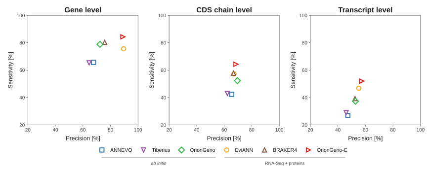
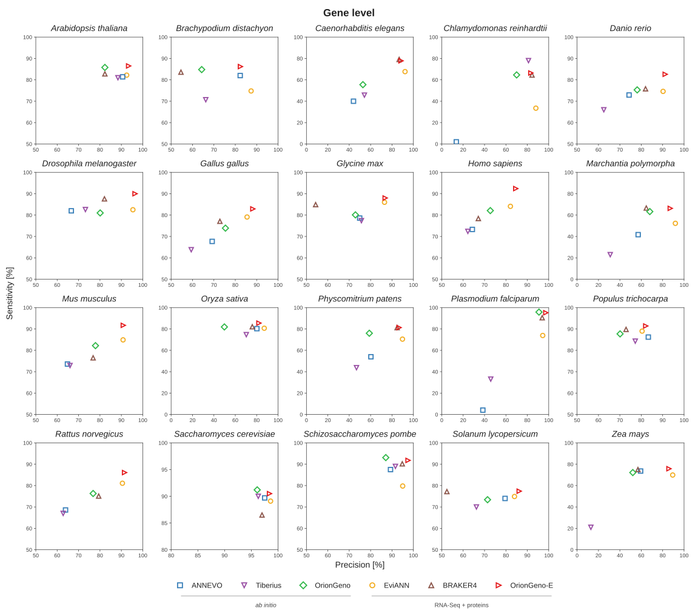
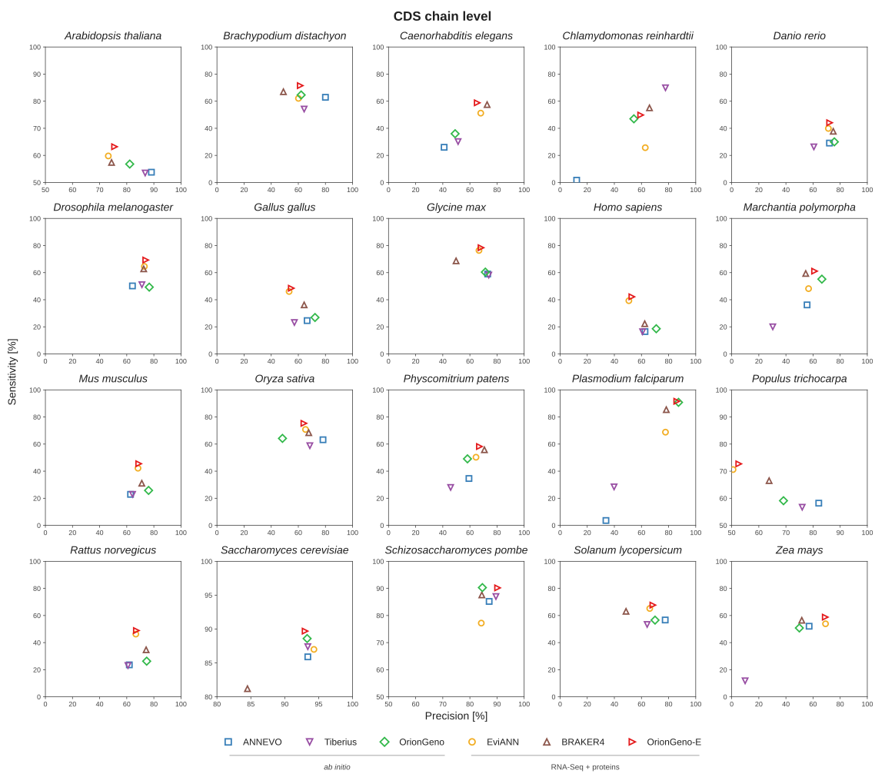
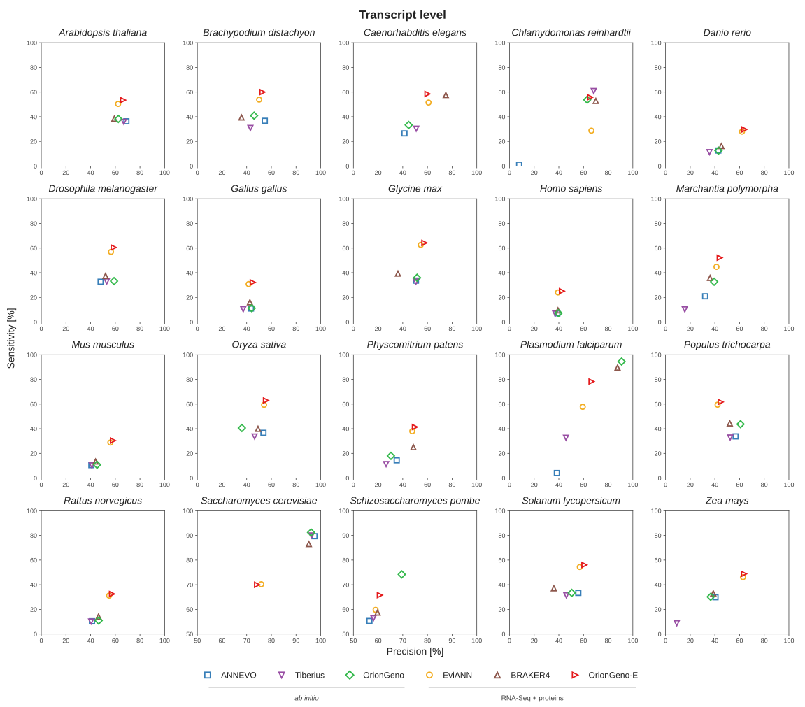
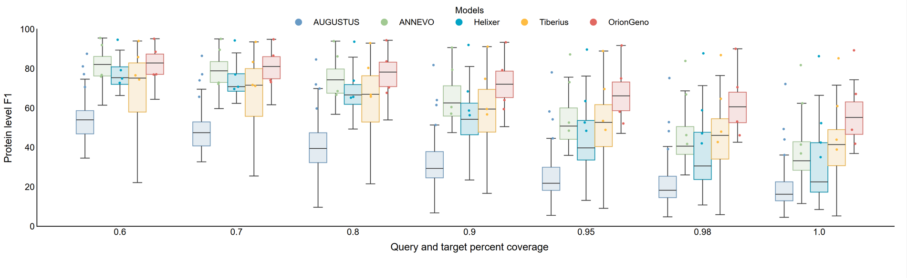

# Advancing ab initio gene annotation with OrionGeno

<p align="center">
  <strong>OrionGeno takes a genome FASTA and produces gene annotations in GFF3 or GTF format.</strong>
</p>

<p align="center">
  
  <a href="https://db.cngb.org/genomics/orion_geno"></a>
  <a href="https://huggingface.co/BGI-Research/OrionGeno"></a>
  <a href="https://modelscope.cn/models/BGI-Research/OrionGeno/files"></a>
  
  
  
</p>

<p align="center">
  
</p>

<p align="center">
  <sub>Mean precision and sensitivity across 20 species at gene, CDS chain, and transcript levels. <a href="docs/figures/benchmark-overview.svg">SVG</a></sub>
</p>

## What OrionGeno Does

OrionGeno is a deep learning-based *ab initio* model for eukaryotic gene annotation. It takes FASTA-formatted genomic sequences as input and generates GFF3 or GTF annotations for gene structures, including exons, introns, UTRs, and optional repeat regions. Powered by a phylogeny-aware architecture, it achieves state-of-the-art accuracy across diverse lineages, including Vertebrates, Invertebrates, Viridiplantae, and Fungi.

## Online API

An online OrionGeno API is available at [https://db.cngb.org/genomics/orion_geno](https://db.cngb.org/genomics/orion_geno). We welcome researchers to test the service and share feedback. The API will be updated continuously as additional curated species annotations become available.

## Benchmark

[Benchmark results](docs/benchmark.md): 20 species, with gene, CDS chain, and
transcript accuracy, runtime, and checkpoint details.

**Benchmark hardware:** 32 CPU threads + 2 × NVIDIA RTX 4090 D GPUs.

<details>
<summary>Gene-level results for all 20 species</summary>



</details>

<details>
<summary>CDS chain-level results for all 20 species</summary>



</details>

<details>
<summary>Transcript-level results for all 20 species</summary>



</details>

<details>
<summary>V1.0.1 gene and protein benchmark</summary>

- [Gene benchmark](docs/benchmark/gene_benchmark.md)
- [Protein benchmark](docs/benchmark/protein_benchmark.md)

<p align="center">
  
</p>

<p align="center">
  <sub>Figure 2. Mean protein-level F1 across the tested models at coverage thresholds from 0.6 to 1.0. <a href="docs/img/Fig2.png">HD</a></sub>
</p>

</details>

## Installation

#### Environment

- Linux
- Python `>=3.10,<3.11`
- NVIDIA GPU, compute capability `>=7.0` (Volta or newer: e.g. V100, RTX
  20/30/40-series, A100, A40, H100). The validated `torch==2.7.0+cu126`
  wheel is compiled for `sm_50` through `sm_90`, but the `mamba-ssm`/
  `causal-conv1d` native kernels are only tested on Turing and newer in
  practice; older GPUs (Pascal/Maxwell) are not verified to work even
  though the PyTorch wheel itself supports them.
- NVIDIA driver `>=525.60.13` (Linux), for CUDA 12.x minor-version
  compatibility. PyTorch's `+cu126` wheel bundles its own CUDA 12.6 runtime,
  so no separate CUDA toolkit install is required on the host.

#### Create and Install

Clone the repository first:

```bash
git clone https://github.com/BGIResearch/OrionGeno.git
cd OrionGeno
```

Then follow the validated installation path in
[docs/oriongeno-installation-success-notes.md](docs/oriongeno-installation-success-notes.md).
That guide keeps package caches, temporary files, native extension builds, and
downloaded wheels inside the repository directory, and documents the tested
Python 3.10, PyTorch 2.7.0, CUDA 12.x, `mamba-ssm`, and `causal-conv1d`
installation path.

Install the Python package after its inference dependencies:

```bash
python -m pip install .
oriongeno --version
```

The version command prints `1.0.2`.

#### Docker

A `Dockerfile` is provided as a ready-to-run alternative to the manual
install above, using the same validated PyTorch, `mamba-ssm`/`causal-conv1d`,
and `numba` versions. Model weights are **not** baked into the image;
download them from Hugging Face or ModelScope (see Download Model Weights
below) and mount the checkpoint directory at run time. This requires a host
meeting the Environment requirements above, plus the
[NVIDIA Container Toolkit](https://docs.nvidia.com/datacenter/cloud-native/container-toolkit/latest/install-guide.html)
installed and configured for Docker. Confirm GPU access works before
proceeding:

```bash
docker run --rm --gpus all nvidia/cuda:12.6.3-base-ubuntu22.04 nvidia-smi
```

If that fails, install/configure the NVIDIA Container Toolkit first; it is
not bundled with Docker itself.

[.github/workflows/docker-publish.yml](.github/workflows/docker-publish.yml)
builds and publishes an image to GHCR on every tagged release
(`ghcr.io/bgiresearch/oriongeno`). Until the first tagged release runs,
build locally instead:

```bash
docker build -t oriongeno .
```

If the default PyPI/Debian mirrors are slow for you, pass a regional mirror
at build time:

```bash
docker build \
  --build-arg PIP_INDEX_URL=https://pypi.tuna.tsinghua.edu.cn/simple/ \
  --build-arg APT_MIRROR=mirrors.tuna.tsinghua.edu.cn \
  -t oriongeno .
```

Verify the image loads and the CLI runs before pointing it at real data:

```bash
docker run --rm --gpus all oriongeno --help
```

Run gene prediction on one GPU:

```bash
docker run --rm --gpus all \
  -v /path/to/oriongeno-weights/checkpoints/oriongeno_mammals:/weights:ro \
  -v /path/to/genome.fna:/data/genome.fna:ro \
  -v /path/to/output:/data/out \
  oriongeno \
  --genome /data/genome.fna \
  --output /data/out/oriongeno.gtf \
  --checkpoint /weights
```

Run gene prediction on multiple GPUs:

```bash
docker run --rm --gpus all \
  -v /path/to/oriongeno-weights/checkpoints/oriongeno_mammals:/weights:ro \
  -v /path/to/genome.fna:/data/genome.fna:ro \
  -v /path/to/output:/data/out \
  oriongeno \
  multi \
  --genome /data/genome.fna \
  --output /data/out/oriongeno.gtf \
  --checkpoint /weights \
  --devices 0,1,2,3
```

## Download Model Weights

Download the inference checkpoints from either Hugging Face or ModelScope via the links below:

| Model       | Hugging Face                                                            | ModelScope                                                                          |
|:-----------:|:----------------------------------------------------------------------- |:----------------------------------------------------------------------------------- |
| `OrionGeno` | [BGI-Research/OrionGeno](https://huggingface.co/BGI-Research/OrionGeno) | [BGI-Research/OrionGeno](https://modelscope.cn/models/BGI-Research/OrionGeno/files) |

For example, with Hugging Face:

```bash
git lfs install
git clone https://huggingface.co/BGI-Research/OrionGeno /path/to/oriongeno-weights
```

Or with ModelScope:

```bash
modelscope download --model BGI-Research/OrionGeno --local_dir /path/to/oriongeno-weights
```

To improve gene structure prediction accuracy across diverse species, OrionGeno provides lineage-specific checkpoint directories for groups such as mammals, birds, fish, other vertebrates, arthropods, other invertebrates, plants, and fungi. Download the checkpoint directory that matches your target lineage and pass that exact directory with `--checkpoint`.

For example:

```text
/path/to/oriongeno-weights/checkpoints/oriongeno_mammals/
```

Pass the directory containing `config.json` and the model weight files.

## Quick Start

### Inputs

Three filesystem paths are required:

- checkpoint directory downloaded from Hugging Face or ModelScope
- genome FASTA input
- output GFF3 or GTF path

Specifying `--species-name` is optional. It is used only for species conditioning inside the selected checkpoint; it does not select or validate a checkpoint directory.

### Execution

Run gene prediction on one GPU:

```bash
python main.py \
  --genome /path/to/genome.fna \
  --output /path/to/output/oriongeno.gtf \
  --checkpoint /path/to/oriongeno-weights/checkpoints/oriongeno_mammals \
  --length 640000 \
  --flank 40000 \
  --batch-size auto \
  --hmm-decode-batch auto \
  --output-gene True \
  --output-repeat False \
  --species-name Homo_sapiens
```

Run gene prediction on multiple GPUs:

```bash
python main.py multi \
  --genome /path/to/genome.fna \
  --output /path/to/output/oriongeno.gtf \
  --checkpoint /path/to/oriongeno-weights/checkpoints/oriongeno_mammals \
  --devices 0,1 \
  --length 640000 \
  --flank 40000 \
  --batch-size auto \
  --hmm-decode-batch auto \
  --output-gene True \
  --output-repeat False \
  --species-name Homo_sapiens
```

Run without species conditioning:

```bash
python main.py \
  --genome /path/to/genome.fna \
  --output /path/to/output/oriongeno.gtf \
  --checkpoint /path/to/oriongeno-weights/checkpoints/oriongeno_mammals \
  --length 640000 \
  --flank 40000 \
  --batch-size auto \
  --hmm-decode-batch auto \
  --output-gene True \
  --output-repeat False
```

In V1.0.2, `--batch-size auto` and `--hmm-decode-batch auto` size the neural
model and HMM batches independently. The values below can also be used as
manual starting points:

| GPU      | Manual batch size      |
|:-------- |:---------------------- |
| RTX 4090 | `4`                    |
| A40      | `8`                    |
| A100     | `16`                   |

If CUDA memory is insufficient, lower `--batch-size`.

### Outputs

OrionGeno generates annotations for genes and optional repeats. At least one of `--output-gene` or `--output-repeat` must be set to `True`.

Gene annotations are written directly to the file path specified by `--output` when `--output-gene True`:

```text
/path/to/output/oriongeno.gtf
```

Gene annotations contain genes, transcripts, exons, CDS, and UTRs.

Repeat annotations are generated beside the gene annotation when `--output-repeat True`. If `--output` is `/path/to/output/oriongeno.gtf`, the repeat output is:

```text
/path/to/output/oriongeno.repeat.gtf
```

Use `.gff` or `.gff3` for GFF3 output, or `.gtf` for GTF. Both formats support
an additional `.gz` extension. The installed `oriongeno` command and
`python -m oriongeno` accept the same prediction arguments as `python main.py`.

## Arguments

| Parameter | Default | Meaning |
| --- | --- | --- |
| `--genome` | required, or `ORIONGENO_GENOME` | Input genome FASTA. |
| `--checkpoint` | required, or `ORIONGENO_CHECKPOINT` | Directory containing the model configuration and weights. |
| `--output` | required, or `ORIONGENO_OUT` | `.gff`/`.gff3` for GFF3, `.gtf` for GTF; optional `.gz`. |
| `--length` | `640000` | Output window length in bases. |
| `--flank` | `40000` | Context added on each side of an output window. |
| `--batch-size` | `auto` | Neural-model batch size. An integer sets it explicitly. |
| `--hmm-decode-batch` | `auto` | HMM batch size; `0` reuses the neural-model batch size. |
| `--hmm-parallel-factor` | `0` | HMM chunk parallelism; `0` selects it automatically. |
| `--window-sizing` | `legacy` | `legacy`, `compact-short`, or `compact`. |
| `--gene-filter-mode` | `none` | `strict` applies coding-structure filtering to the requested output. |
| `--output-gene` | `True` | Write gene annotations. |
| `--output-repeat` | `False` | Write repeat annotations beside the gene output. |
| `--species-name` | empty | Optional species conditioning inside the selected checkpoint. |
| `--profile-hmm` | `False` | Report prediction and HMM timing. |

Multi-GPU mode also accepts:

| Parameter | Default | Meaning |
| --- | --- | --- |
| `--devices` | `auto` | Comma-separated GPU IDs, or automatic device discovery. |
| `--window-task-size` | `32` | Sequence windows assigned to a worker per task. |
| `--work-dir` | derived from output | Temporary prediction directory. |
| `--keep-work-dir` | off | Retain temporary prediction files after success. |

See the [parameter guide](docs/oriongeno-parameter-guide.md) for environment
variables, assembly packing, and multi-node options.

## Acceleration and Memory Optimization

### Fragmented Assemblies and CPU Memory

For highly fragmented assemblies, running every short scaffold as an independent
inference record would create heavy scheduling overhead. In `auto` mode,
OrionGeno can pack short scaffolds into pseudo-contigs and then remap predictions
back to the original FASTA records after inference. This improves throughput on
draft assemblies with many scaffolds.

CPU memory peaks are mainly controlled by how much sequence is prepared for a
prediction group at one time. To lower CPU memory usage, reduce the sequence
group target:

```bash
ORIONGENO_SEQUENCE_GROUP_SIZE=4000000 python main.py ...
```

If a fragmented assembly still creates very large packed records, reduce the
packed pseudo-contig target size as well:

```bash
ORIONGENO_PACK_TARGET_SIZE=10000000 python main.py ...
```

Smaller values reduce memory peaks but may increase the number of groups and
slightly reduce throughput.

### GPU Memory

For GPU memory pressure, reduce `--batch-size`:

```bash
python main.py ... --batch-size 2
```

The prediction runner also sets the following PyTorch allocator option unless it
is already configured:

```text
PYTORCH_CUDA_ALLOC_CONF=expandable_segments:True
```

### V1.0.2 Performance Changes

- Keep a loaded checkpoint in each GPU worker and distribute sequence windows
  across those workers, including windows from long chromosomes.
- Tune model-forward and HMM decode batches independently, with memory backoff.
- Overlap model prediction and HMM decoding and reuse model outputs between stages.
- Load checkpoint weights without an unnecessary random initialization pass.
- Limit inference thread pools and avoid clearing the CUDA cache on every batch.
- Normalize cumulative CPU Viterbi scores to preserve float32 decoding precision.

The [version history](docs/versions.md) records V1.0.1 and V1.0.2 changes.

## Troubleshooting

If `mamba-ssm` or `causal-conv1d` fails to install, follow the validated wheel-based path in [docs/oriongeno-installation-success-notes.md](docs/oriongeno-installation-success-notes.md). Also confirm that the CUDA runtime, PyTorch build, and NVIDIA driver are compatible.

If prediction fails before inference starts, check that `--genome`, `--checkpoint`, and `--output` are set correctly, and that the checkpoint path points to the exact lineage-specific checkpoint directory you want to use.

## Documentation

- [Documentation index](docs/README.md)
- [Installation](docs/oriongeno-installation-success-notes.md)
- [Parameters](docs/oriongeno-parameter-guide.md)
- [Multi-GPU and multi-node prediction](docs/multi-gpu.md)
- [Benchmark](docs/benchmark.md)
- [Version history](docs/versions.md)
- [Development tests](tests/README.md)

## License

OrionGeno is distributed under the **OrionGeno Non-Commercial License (Academic & Non-Commercial Use Only)**.
The code and model weights in this repository are personal/academic research achievements.
To prevent unauthorized commercial exploitation, this project is released under a non-commercial license.
Commercial use requires a separate license.

1. **Academic & Non-Commercial Use**: You are free to use, modify, and distribute the software **strictly** for non-commercial, academic, and scientific research purposes, in compliance with this license.

2. **Commercial Use**: Any commercial utilization, including but not limited to selling the software, integrating it into commercial platforms, using it for enterprise internal production, or providing paid cloud services, is **strictly prohibited** without prior written permission and a separate commercial license from BGI-Research.

*For commercial licensing inquiries and formal cooperation, please [contact the development team](mailto:yinpeng@genomics.cn).*

## Citation

If you use this codebase, or otherwise find our work valuable, please cite OrionGeno:

Lin Liu, Xudong Cai, Shengfu Wang, Yuan Deng, Yiwen Wu, Youliang Pan, Jieyu Wang, Chao Zhang, Haopeng Xia, Nongzhang Tan, Kui Su, Yang Liu, Xuping Zhou, Longqi Liu, Tong Wei, Yong Zhang, Qiye Li, Yuxiang Li, Peng Yin, Xun Xu. Advancing ab initio genome annotation with OrionGeno. Preprint at bioRxiv https://doi.org/10.64898/2026.04.26.720859 (2026).

If you have any questions, please contact: yinpeng@genomics.cn
